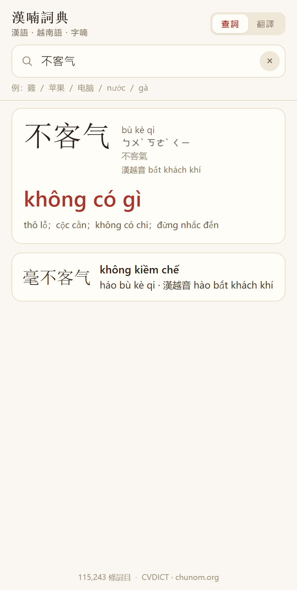
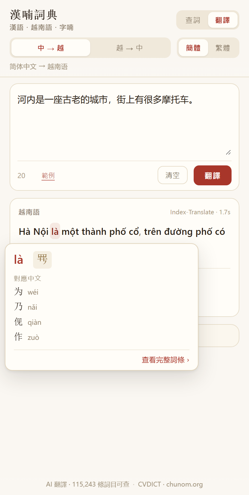

# Sino-Vietnamese Dictionary

<p align="center"></p>

[中文](README.md) · [Tiếng Việt](README.vi.md) · [English](README.en.md)

**漢南辭典** · Từ điển Trung–Việt

A **Chinese ⇄ Vietnamese** dictionary for Chinese speakers, with Chữ Nôm glyphs and AI translation. Offline-first, one codebase running on the web, Windows and Android.

**[▶ Use it now](https://siqyin.github.io/zhongviet-translate-web/)** · [Download desktop / Android](https://github.com/SiqYin/zhongviet-translate/releases/latest)

<p align="center">
  
  
</p>

## What makes it different

Look up「雞」in a typical Chinese–Vietnamese dictionary and you get `gà`. Nothing tells you that the Sino-Vietnamese reading of「雞」is `kê`, or what else `gà` combines with.

This dictionary gives you:

```
雞  jī  ㄐㄧ  繁體 雞  漢越音 kê
gà
├ Starting with “gà”   公雞 gà trống · 小雞 gà con · 母雞 gà mái
└ Containing “gà”      雞肉 thịt gà · 鬥雞 chọi gà · 雞蛋 trứng gà
```

Vietnamese speakers say `gà`, but「雞」was borrowed into Vietnamese as `kê`. With both lines marked, you can tell native words from Sino-Vietnamese loans.

The Sino-Vietnamese reading is an annotation only — it never becomes a separate entry.

## Features

**Dictionary**

- Chinese (simplified or traditional) → the actual Vietnamese word, pinyin, zhuyin, traditional form, Sino-Vietnamese reading, and word family
- Vietnamese (tones optional) → matching Chinese words, ranked by sense fit
- Single characters carry Nôm glyphs, radical, stroke count and structure

**AI translation**

- Four directions: simplified ⇄ Vietnamese, traditional ⇄ Vietnamese
- Output is tokenised; **hover any word (tap on mobile) to look it up instantly**
- Defaults to the free public [Index-Translate](https://github.com/bilibili/Index-Translate) endpoint; any OpenAI-compatible endpoint works
- Falls back to a word-by-word dictionary gloss when offline

## Downloads

| Platform | File | Notes |
|---|---|---|
| Windows | [HanVietDict-setup.exe](https://github.com/SiqYin/zhongviet-translate/releases/latest/download/HanVietDict-setup.exe) | Installer, ~85 MB |
| Android | [zhongviet-translate.apk](https://github.com/SiqYin/zhongviet-translate/releases/latest/download/zhongviet-translate.apk) | Android 5.1+ |
| Web | [siqyin.github.io/zhongviet-translate-web](https://siqyin.github.io/zhongviet-translate-web/) | Nothing to install |

The two links above always point at the **latest release**; older builds are in [Releases](https://github.com/SiqYin/zhongviet-translate/releases).

## Data

- **115,243 entries**: Chinese headword + pinyin + Vietnamese senses (up to 5)
- 112,934 entries carry Sino-Vietnamese readings — single characters list **all** readings, primary first (e.g. 行 → hành、hàng、hạnh、hạng); 10,934 carry a Nôm glyph
- **113,934 entries** were checked against AI; **83,761** were rewritten

## Interface languages

简体中文、繁體中文、Tiếng Việt、English. The app picks up the system language on first launch, and defaults to English if the system language is none of these.

## Fonts

The whole interface (simplified, traditional, Vietnamese) uses **LXGW WenKai**; Nôm text uses **Nom Na Tong**, never mixed, so a line of Nôm keeps one consistent style.

| Font | Used for | License | Bundled size |
|---|---|---|---|
| [LXGW WenKai](https://github.com/lxgw/LxgwWenKai) | Chinese, Vietnamese, Latin, zhuyin | SIL OFL 1.1 | 3.0 MB |
| [Nom Na Tong](https://github.com/nomfoundation/font) | Nôm only | MIT | 221 KB |

## Development

```bash
npm install
npm run serve                # preview at http://localhost:5173

npm run dist:win             # Windows
npx cap sync android && cd android && ./gradlew assembleDebug   # Android (JDK 17 + SDK 34)
```

Android can also be built in CI: push to `main` and download the `android-apk` artifact from Actions.

## Data sources & licenses

| Source | Used for | License |
|---|---|---|
| [CVDICT](https://github.com/ph0ngp/CVDICT) | Chinese–Vietnamese entries | CC BY-SA 4.0 |
| [chunom.org](https://chunom.org) | Nôm glyphs | pending, see `NOTICE.md` |
| [OpenCC](https://github.com/BYVoid/OpenCC) | traditional/simplified conversion | Apache-2.0 |
| [Unihan](https://www.unicode.org/Public/UCD/latest/ucd/Unihan/) | readings, radicals | Unicode License |
| [Index-Translate](https://github.com/bilibili/Index-Translate) | translation model | Apache-2.0 |

## Known limitations

- Nôm covers about 10,900 entries; no Nôm reverse lookup yet
- Some rare words are translated a bit too literally
- Example sentences not included yet
