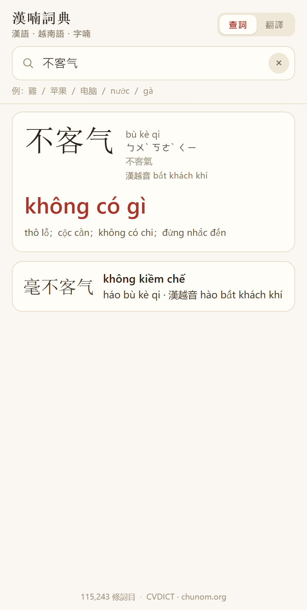
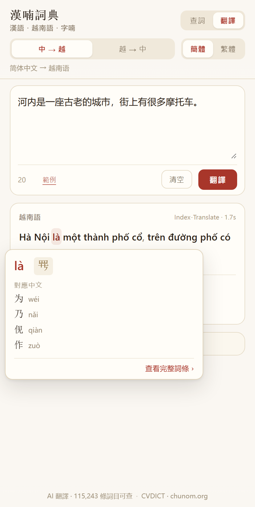

# 漢喃詞典 · zhongviet-translate

面向中文母語者的**漢語 ⇄ 越南語**詞典，帶字喃（Chữ Nôm）字形與 AI 翻譯。離線優先，同一套程式碼跑在網頁、Windows、Android 三端。

**[▶ 線上使用](https://siqyin.github.io/zhongviet-translate-web/)** · [下載桌面版／Android](https://github.com/SiqYin/zhongviet-translate/releases)

<p align="center">
  
  
</p>

## 它和一般漢越詞典不一樣的地方

查「雞」，一般漢越詞典給你 `gà`，到此為止。它不會告訴你 `kê` 是「雞」的漢越音，也不會告訴你 `gà` 還能組成哪些詞。

這本詞典查「雞」給你的是：

```
雞  jī  ㄐㄧ  繁體 雞  漢越音 kê
gà
├ 以「gà」開頭   公雞 gà trống · 小雞 gà con · 母雞 gà mái
└ 包含「gà」     雞肉 thịt gà · 鬥雞 chọi gà · 雞蛋 trứng gà
```

越南人說 `gà`，但「雞」這個字借進越南語時念 `kê`。兩條線都標出來，你才分得清哪個是固有詞、哪個是漢越詞，也才看得出 `kê` 系的詞和「雞」的關係。字喃若收錄，會一併顯示。

漢越音只作標註，不單獨成條。詞條留給真正的對譯。

## 功能

**查詞**

- 中文（簡體或繁體）→ 越南語實際用詞、拼音、注音、繁簡、漢越音，以及詞族
- 越南語（可省略聲調）→ 對應中文詞，按義項貼合度排序
- 單字附字喃字形、部首、筆畫、部件結構

**AI 翻譯**

- 四種方向：簡體中文 ⇄ 越南語、繁體中文 ⇄ 越南語
- 譯文按詞切分，**滑鼠移到任一個詞上（手機點一下）就彈出該詞的詞典釋義**
- 中文用最大匹配分詞，詞表就是詞典本身；越南語按音節合併成詞（`Hôm qua`、`đi làm`、`bị sốt`）
- 預設接 [Index-Translate](https://github.com/bilibili/Index-Translate) 免費公共介面，可換成任何 OpenAI 相容端點
- 斷網時可切「詞庫逐詞對照」

## 下載

| 平台 | 檔案 | 說明 |
|---|---|---|
| Windows | `HanVietDict-1.1.0-setup.exe` | 安裝版，約 81 MB |
| Android | `zhongviet-translate-1.1.0.apk` | 直接安裝，需 Android 5.1+ |
| 網頁 | [siqyin.github.io/zhongviet-translate-web](https://siqyin.github.io/zhongviet-translate-web/) | 免安裝 |

## 資料規模

- **115,243 條詞目**：中文詞頭 + 拼音 + 越南語義項（最多 5 條）
- 112,934 條有漢越音，10,934 條有字喃字形
- **113,934 條**已逐條送 AI 校對，其中 **83,761 條**實際改寫（其餘原本就正確或觸發保護規則被跳過）
- 改寫明細：修正錯義 15,562 條、收窄冗長釋義 1,922 條、同義替換 66,277 條

## 技術架構

| 層 | 做法 |
|---|---|
| 前端 | 純 HTML/CSS/JS，無框架、無建置步驟，12 MB 詞庫以單一 JS 檔載入 |
| 分詞 | 中文後向最大匹配（詞表即詞庫，11.5 萬詞頭）；越南語按音節做 1–4 詞合併 |
| 詞典索引 | 簡繁雙向 Map；越南語反查建 n-gram 倒排索引，索引未建好時退回線性掃描 |
| 查詢 | 完全相等 > 詞首 > 詞中 > 子串，同分再按詞頻與詞長 |
| 翻譯 | OpenAI 相容 chat/completions，預設 `Index-Translate-35B-A3B`，可自架 |
| 桌面 | Electron 33 + electron-builder（NSIS） |
| Android | Capacitor 6 + Gradle 8.2.1（compileSdk 34，minSdk 22） |
| CI | GitHub Actions 產出 APK artifact |
| 網頁 | 建置產物推送到公開倉庫，由 GitHub Pages 託管 |

## 本地開發

```bash
npm install

# 網頁預覽
npm run serve          # python -m http.server 5173 --directory app
```

### 建置

```bash
# Windows 安裝檔
npm run dist:win

# Android（需要 JDK 17 + Android SDK 34）
npx cap sync android
cd android && ./gradlew assembleDebug
```

Android 也可以直接走 CI：推送 `main` 後在 Actions 下載 `android-apk` artifact。

### 重新生成詞庫

```bash
python tools/build_zhvi.py               # CVDICT → app/zhvi.js（約 12 MB）

# 可選：AI 批量校正，結果快取，可中斷續跑
python tools/ai_correct.py --tier all
python tools/make_ai_fix.py
python tools/build_zhvi.py
```

## 資料來源與授權

| 來源 | 用途 | 授權 |
|---|---|---|
| [CVDICT](https://github.com/ph0ngp/CVDICT) | 中越詞條 | CC BY-SA 4.0 |
| [chunom.org](https://chunom.org) | 字喃字形 | 洽談中，見 `NOTICE.md` |
| [OpenCC](https://github.com/BYVoid/OpenCC) | 繁簡轉換 | Apache-2.0 |
| [Unihan](https://www.unicode.org/Public/UCD/latest/ucd/Unihan/) | 漢越音、部首筆畫 | Unicode License |
| [Index-Translate](https://github.com/bilibili/Index-Translate) | 翻譯模型 | Apache-2.0 |

CVDICT 帶 CC BY-SA，轉載或再發布需署名並以相同方式共享。

## 漢越音怎麼定的

一個字在復音詞裡最常讀什麼音，就取哪個作主讀音——統計對象是詞典自己的 10 萬個復音詞。

例：長在復音詞裡讀 trường 390 次、trưởng 162 次，取 trường；重讀 trọng 230 次、trùng 177 次，取 trọng。

這樣定出 48 個多音字的主讀音（長、重、空、散、應、將……），復音詞本身的漢越音未受影響。
取音來源另有審計：9,489 個單字裡，5,523 條屬「該字只有一個讀音」的正常情況，
真正可疑的 62 條已逐條核過，明細見 `data/hv_suspect.tsv`。

## 已知限制

- 字喃僅覆蓋約 10,900 條，且不支援用字喃反查
- 長尾詞的越南語對應仍有部分偏直譯，逐條明細在 `data/ai_fix_report.tsv`
- 漢越音按復音詞頻率定主讀音，少數字（如 樂 lạc／nhạc、藏 tạng／tàng）兩讀皆通行
- 例句尚未接入
