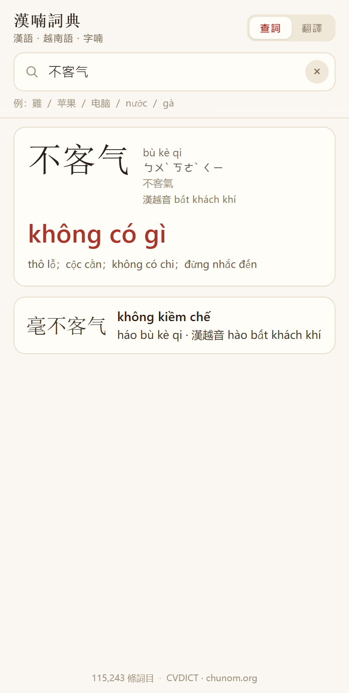
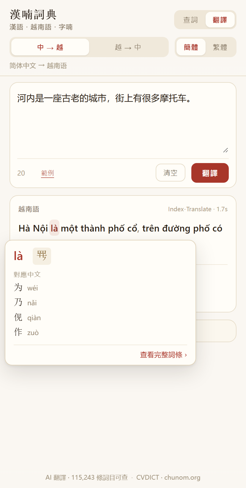

# Từ điển Trung–Việt

<p align="center"></p>

[中文](README.md) · [Tiếng Việt](README.vi.md) · [English](README.en.md)

**漢南辭典** · Sino-Vietnamese Dictionary

Từ điển **Hán ⇄ Việt** dành cho người dùng tiếng Trung, có chữ Nôm và dịch AI. Ưu tiên ngoại tuyến, một bộ mã chạy trên ba nền tảng: web, Windows, Android.

**[▶ Dùng ngay](https://siqyin.github.io/zhongviet-translate-web/)** · [Tải bản desktop / Android](https://github.com/SiqYin/zhongviet-translate/releases/latest)

<p align="center">
  
  
</p>

## Khác với các từ điển Hán–Việt thông thường

Tra「雞」ở từ điển Hán–Việt thông thường, bạn chỉ nhận được `gà`. Không ai nói cho bạn biết âm Hán Việt của「雞」là `kê`, và `gà` còn ghép được với những từ nào.

Từ điển này cho bạn:

```
雞  jī  ㄐㄧ  繁體 雞  漢越音 kê
gà
├ Bắt đầu bằng「gà」  公雞 gà trống · 小雞 gà con · 母雞 gà mái
└ Chứa「gà」          雞肉 thịt gà · 鬥雞 chọi gà · 雞蛋 trứng gà
```

Người Việt nói `gà`, nhưng chữ「雞」vay sang tiếng Việt đọc là `kê`. Khi cả hai đường được đánh dấu, bạn phân biệt được từ thuần Việt và từ Hán–Việt.

Âm Hán Việt chỉ là chú thích, không tách thành mục từ riêng.

## Tính năng

**Tra từ**

- Tiếng Trung (giản thể hoặc phồn thể) → từ Việt thực dùng, pinyin, chú âm, phồn thể, âm Hán Việt và hệ từ
- Tiếng Việt (bỏ dấu vẫn tra được) → các từ Hán tương ứng, xếp theo mức độ khớp nghĩa
- Chữ đơn kèm chữ Nôm, bộ thủ, số nét, cấu tạo chữ
- Kèm ví dụ song ngữ (câu tiếng Trung + bản dịch tiếng Việt), tạo từng mục và được rà lỗi câu

**Dịch AI**

- Bốn hướng: giản thể ⇄ tiếng Việt, phồn thể ⇄ tiếng Việt
- Bản dịch được tách theo từ; **di chuột lên từ bất kỳ (chạm trên điện thoại) để tra nghĩa ngay**
- Mặc định dùng [Index-Translate](https://github.com/bilibili/Index-Translate) miễn phí, đổi được sang bất kỳ điểm cuối tương thích OpenAI nào
- Khi mất mạng có chế độ tra từng từ trong từ điển

## Tải về

| Nền tảng | Tệp | Ghi chú |
|---|---|---|
| Windows | [HanVietDict-setup.exe](https://github.com/SiqYin/zhongviet-translate/releases/latest/download/HanVietDict-setup.exe) | Bản cài, ~85 MB |
| Android | [zhongviet-translate.apk](https://github.com/SiqYin/zhongviet-translate/releases/latest/download/zhongviet-translate.apk) | Android 5.1+ |
| Web | [siqyin.github.io/zhongviet-translate-web](https://siqyin.github.io/zhongviet-translate-web/) | Không cần cài |

Hai liên kết trên luôn trỏ tới **bản mới nhất**; bản cũ nằm ở [Releases](https://github.com/SiqYin/zhongviet-translate/releases).

## Quy mô dữ liệu

- **115.243 mục từ**: từ Trung + pinyin + nghĩa tiếng Việt (tối đa 5 nghĩa)
- 112.934 mục có âm Hán Việt (mục một chữ liệt kê **toàn bộ** âm Hán Việt của chữ đó, âm chính đứng trước, ví dụ 行 → hành、hàng、hạnh、hạng), 10.934 mục có chữ Nôm
- **113.934 mục** đã được đưa qua AI đối chiếu, trong đó **83.761 mục** được sửa lại

## Giao diện

Bốn ngôn ngữ: 简体中文、繁體中文、Tiếng Việt、English.
Ứng dụng tự nhận ngôn ngữ hệ thống khi khởi động; nếu không nằm trong bốn ngôn ngữ trên thì mặc định tiếng Anh.

## Phông chữ

Toàn bộ giao diện (giản thể, phồn thể, tiếng Việt) dùng **LXGW WenKai**; chữ Nôm dùng **Nom Na Tong**, không trộn lẫn để giữ phong cách thống nhất.

| Phông | Dùng cho | Giấy phép | Dung lượng |
|---|---|---|---|
| [LXGW WenKai](https://github.com/lxgw/LxgwWenKai) | Hán tự, tiếng Việt, Latinh, chú âm | SIL OFL 1.1 | 3.0 MB |
| [Nom Na Tong](https://github.com/nomfoundation/font) | Chữ Nôm | MIT | 221 KB |

## Phát triển

```bash
npm install
npm run serve                # xem trước ở http://localhost:5173

npm run dist:win             # Windows
npx cap sync android && cd android && ./gradlew assembleDebug   # Android (cần JDK 17 + SDK 34)
```

Android cũng có thể build qua CI: đẩy lên `main`, tải artifact `android-apk` từ Actions.

## Nguồn dữ liệu & giấy phép

| Nguồn | Dùng cho | Giấy phép |
|---|---|---|
| [CVDICT](https://github.com/ph0ngp/CVDICT) | mục từ Hán–Việt | CC BY-SA 4.0 |
| [chunom.org](https://chunom.org) | chữ Nôm | đang thương lượng, xem `NOTICE.md` |
| [OpenCC](https://github.com/BYVoid/OpenCC) | chuyển phồn–giản | Apache-2.0 |
| [Unihan](https://www.unicode.org/Public/UCD/latest/ucd/Unihan/) | âm Hán Việt, bộ thủ | Unicode License |
| [Index-Translate](https://github.com/bilibili/Index-Translate) | mô hình dịch | Apache-2.0 |

## Giới hạn còn lại

- Chữ Nôm phủ khoảng 10.900 mục, chưa tra ngược bằng chữ Nôm
- Vài ký tự hiếm (bộ thủ, ký hiệu) không tạo được ví dụ tự nhiên nên thiếu ví dụ
